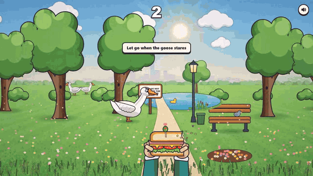
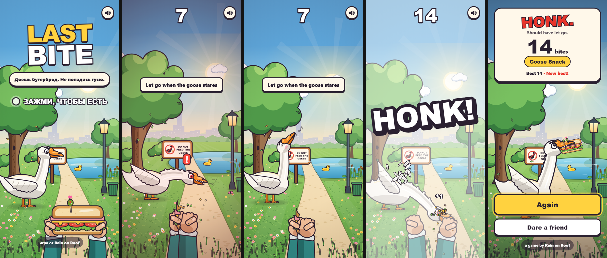
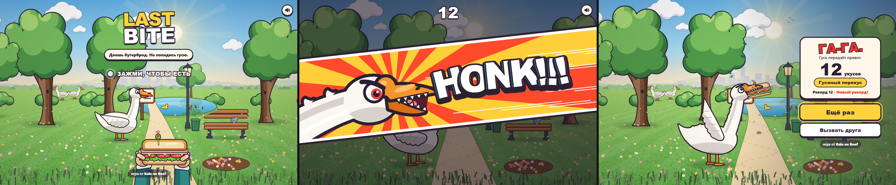

<div align="center">

<a href="https://rain-on-roof.github.io/last-bite/"></a>

<a href="https://rain-on-roof.github.io/last-bite/"></a>

**Eat your sandwich. Don't get honked.**<br>
A tiny browser game by [Rain on Roof](https://github.com/rain-on-roof). You're on a park bench with a sandwich, and a goose has noticed.



</div>

## How to play

- **Hold** (finger, mouse button or <kbd>Space</kbd>) to chew. Every bite scores.
- Chewing is loud. The goose creeps closer and gets angrier.
- When it stares, ruffles up and shows its teeth, **let go**. It will pretend nothing happened.
- Let go at the very last moment for a **CLOSE CALL**: slow motion and +3. Greed pays, if you survive it.
- Still chewing when it strikes? Time freezes, the screen goes manga, and the goose gets its own super-move cut-in. **HONK!!!** Lunch is gone.
- Some stares are bluffs. Sometimes the goose is golden and every bite counts double.
- Hit **Dare a friend** to send a link with your score baked in.

Phone and desktop get their own framing: the park is 960 units tall and as wide as your screen, up to 21:9.




## Under the hood

Plain HTML, ES modules and Canvas 2D: no build step, no dependencies, no server. Everything is drawn in code, sound included.

| File | What it does |
| --- | --- |
| `src/game.js` | The whole game minus pixels: a seeded state machine for the goose (creep, tell, bluff, strike) and scoring |
| `src/render/scene.js` | The park, painted once into offscreen layers, plus clouds, water, the duck and grass animated per frame |
| `src/render/goose.js` | A rig of parts driven by a few pose numbers that spring between moods |
| `src/render/sandwich.js` | The sandwich (bitten with a scalloped cut) and the hands holding it |
| `src/render/honk.js` | The HONK: a two-tone impact frame and a fighting-game cut-in |
| `src/render/fx.js` | Crumbs, feathers, sparkles, pop-up text, shake and flash |
| `src/audio.js` | WebAudio synthesis: crunch, hiss, whistle and an honest attempt at a honk |
| `src/share.js` | Challenge links in the URL hash (`#beat=47`), Web Share or clipboard |
| `src/i18n.js` | English, Russian and Ukrainian, picked from the browser |

## Run it locally

```sh
node tools/serve.mjs     # http://localhost:4517
npm test                 # game logic and share links
```

`tools/og.html` renders the link preview image from the game's own renderer.

## More from Rain on Roof

<a href="https://rain-on-roof.github.io/rain-fight/"></a><br>
**[Rain Fight](https://github.com/rain-on-roof/rain-fight)**: a rooftop fighting game in the rain. The goose came back, and it learned to fight.

---

MIT © Rain on Roof
